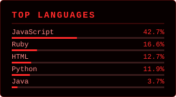

## `// PROFILE DATA`

| FIELD | VALUE |
|-------|-------|
| EDUCATION | M.Sc. in Computer Science, UFPel |
| CERTIFIED | LangGraph Foundation |
| CURRENT WORK | AI agents, LLMs, security hardening for agentic systems, multimodal vision-language models |
| LEARNING | Agentic AI, computer vision, CUDA |
| ASK ME ABOUT | Python, C/C++, Haskell, machine learning, systems programming, LangGraph, FastAPI |
| CONTACT | [LinkedIn](https://linkedin.com/in/ar1vit0r) / [avdslazzarotto@inf.ufpel.edu.br](mailto:avdslazzarotto@inf.ufpel.edu.br) |

## `// SKILL MATRIX`

## `// ACTIVE MISSIONS`

| MISSION | STACK | OBJECTIVE |
|---------|-------|-----------|
| [`rs-water-quality`](https://github.com/ar1vit0r/rs-water-quality) | Python, PostgreSQL | Checks Rio Grande do Sul water-quality data against CONAMA 357 limits. ETL with audit trail, SQL violations view, CI |
| [`nfe-analytics`](https://github.com/ar1vit0r/nfe-analytics) | Python, dbt, PostgreSQL | Synthetic NF-e XML pipeline: generate, parse, validate, load, and model into star-schema marts |
| [`prompt-regression-ci`](https://github.com/ar1vit0r/prompt-regression-ci) | Python, pytest | CI that catches prompt regressions on an LLM ticket classifier using recorded fixtures |
| [`rails-api`](https://github.com/ar1vit0r/rails-api) | Ruby, Rails | API-only app with JWT auth, rate limiting and Swagger docs |
| [`rails-crm`](https://github.com/ar1vit0r/rails-crm) | Ruby, Rails 8 | SaaS-style CRM: lead pipeline, activity log, role-based access |
| [`hyp-computer-sim`](https://github.com/ar1vit0r/hyp-computer-sim) | Rust | Hypothetical computer simulator: assembler, linker, loader and VM |

## `// SYSTEM STATS`

